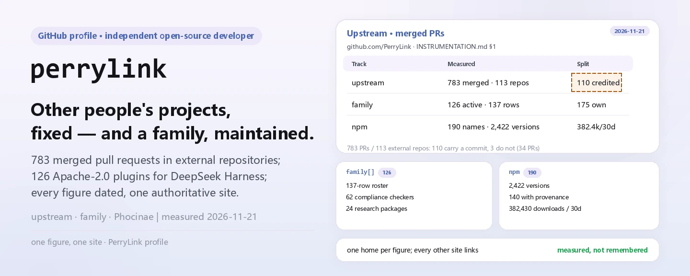
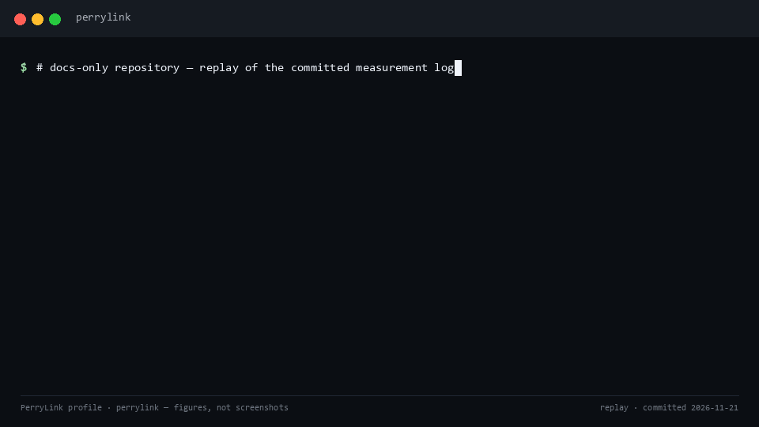
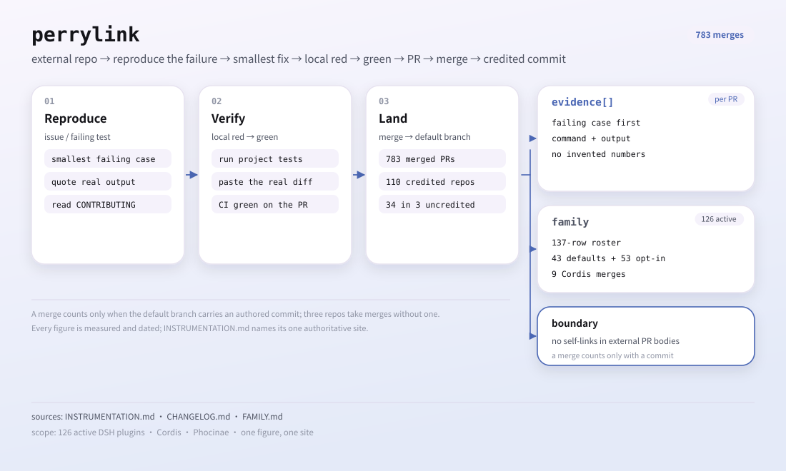

<picture>
  <source media="(prefers-color-scheme: dark)" srcset="docs/assets/perrylink-hero-en-dark.webp">
  
</picture>

# नमस्ते, मैं PerryLink हूँ 👋

**बीजिंग में स्वतंत्र ओपन-सोर्स डेवलपर।**

*एक आँकड़ा, एक स्रोत: इस पेज का हर नंबर मापा गया है, तारीख़ के साथ है, और अपने आधिकारिक स्रोत तक ट्रेस करने योग्य है।*

[English](README.md) · [简体中文](README-zh.md) · [Español](README-es.md) · [Português](README-pt.md) · [हिन्दी](README-hi.md)

---

<!-- Editing note: every figure on this page is measured and dated, and each one has exactly one
     authoritative site. Read INSTRUMENTATION.md before changing a number. This page is self-contained
     since 2026-10-31; rounds go to CHANGELOG.md. -->

 

 

 

“Certified” हमारे अपने परिवार का प्रमाणन है, कोई स्वतंत्र ऑडिट या DeepSeek का समर्थन नहीं। जिन काउंटरों की अपनी तारीख़ नहीं है, वे 2026-11-12 को फिर से मापे गए।

मैं दूसरों के प्रोजेक्ट ठीक करता हूँ, [DeepSeek Harness](https://github.com/deepseek-ai/deepseek-harness) के लिए एक प्लगइन परिवार बनाए रखता हूँ, और [Phocinae](https://github.com/Phocinae) चलाता हूँ — अपनी typed-decision मॉडल प्रयोगशाला। बीजिंग में स्वतंत्र ओपन-सोर्स डेवलपर — DeepSeek से संबद्ध नहीं, और DeepSeek का कर्मचारी नहीं।

**Upstream** — 784 मर्ज किए गए pull requests, 113 ऐसी रिपॉज़िटरी में जो मेरी नहीं हैं, AWS, Apple, Docker, Microsoft, NVIDIA, Prometheus, Redis, Tencent और vLLM प्रोजेक्ट से लेकर एक-व्यक्ति के छोटे प्रोजेक्ट तक। इन 784 में से **750 ने 110 श्रेय-प्राप्त रिपॉज़िटरी की डिफ़ॉल्ट ब्रांच पर commit छोड़ा; 3 रिपॉज़िटरी की 34 मर्जें कोई commit श्रेय नहीं देतीं**, कुल मिलाकर 113 रिपॉज़िटरी। वे तीन हैं `SihanTeng/awesome-deepseek-harness-plugins` (32 मर्जें), `Tencent/MMKV` (1) और `Anil-matcha/open-genjutsu` (1)। **परिवार** — 126 सक्रिय रूप से अनुरक्षित Apache-2.0 प्लगइन: सुरक्षा, वर्कफ़्लो, शोध, मैसेजिंग ब्रिज, डेवलपर अनुभव; 2026-10-08 से 53-जाँच वाली compliance सूट और नौ नए compliance टूल, और 27 बिज़नेस टूल जो 2026-11-03 को task-first प्लगइन मार्केट बने: इनमें से छह finance/contract सूट में जुड़ते हैं, बाक़ी विशेष टूल हैं (इनवॉइसिंग, बैंकिंग, अनुबंध, गुणवत्ता, सीमा शुल्क, लॉजिस्टिक्स, HR, रिटेल, निर्माण, PDF तालिकाएँ, मॉडल पैरामीटर), एक इंस्टॉल साथी है और एक eval यूटिलिटी। **अनुवाद से जुड़ा नाम 2026-11-08 को अलग हुआ:** `dsh-param-repair` (1.0.2) वह vendor-parameter मैपिंग + deterministic JSON रिपेयर प्लगइन है जो पहले `dsh-translate` कहलाता था, और `dsh-translate` (0.3.5) अब एक पूर्ण-पृष्ठ अनुवादक है जो सत्र के अपने मॉडल रूट पर चलता है और कोड, पाथ, कमांड व उत्पाद-नाम जस के तस रखता है। **समय-साक्ष्य (2026-11-09):** `dsh-sherlock` 0.5.0 एक catalog-only स्थानीय वर्कबेंच है सार्वजनिक-स्रोत टाइमलाइन और तारीख़-विरोधों के लिए — पाँच घड़ियाँ, TEG, T-S-C-E, query लेजर, diff/verify/review, और एक स्व-निहित HTML रिपोर्ट; यह साइट नहीं बनाता, लोगों को नहीं खोजता, और सही/ग़लत का फ़ैसला नहीं देता। **27 डोमेन टूल 0.1–0.2 पर हैं, बिना alpha टैग**; अधिकांश के README में स्पष्ट रूप से not-GA लिखा है, हमने जो भी पहला रन आज़माया वह एक pack में क़ैद है, और पाँच परिदृश्य-पैक उन्हें शुरू से आख़िर तक जोड़ते हैं। पुराना `dsh-eval-harness` अब `dsh-eval-pack` है। सार्वजनिक कैटलॉग **[perrylink.github.io](https://perrylink.github.io/)** है — प्लगइन इंडेक्स के अंतर्गत 185 पेज (साइट sitemap जड़ के अलावा 114 URL सूचीबद्ध करता है), पूरे served HTML में, बिना किसी JavaScript रेंडरिंग के, इसलिए खोज-परिणाम से आने वाला पाठक लोडिंग स्थिति की जगह सीधा पाठ देखता है।

मैं **[Cordis](https://github.com/cordiverse/cordis)** में भी योगदान देता हूँ — वह प्लगइन कर्नेल जिसे DeepSeek Harness `@deepseek-ai/cordis` के रूप में शामिल करता है — वहाँ नौ मर्ज किए गए pull requests, async-generator सफ़ाई से लेकर reload व्यवहार तक।

**चीनी पाठक · सिर्फ़ एक दस्तावेज़ जाँचना है?** [अपने पास मौजूद सामग्री के अनुसार एक जाँचक चुनें (पूरी तरह चीनी में) →](https://perrylink.github.io/zh/checkers/choose/) · नए जाँचक और वर्कबेंच टूल भी हैं, देखें [compliance समूह](./FAMILY.md#5-compliance-checkers)।

## ▶ यहाँ से शुरू करें

*एनिमेशन: यह रिपॉज़िटरी केवल दस्तावेज़ है, इसलिए यहाँ चलाने को कुछ नहीं — प्रतिकृति उन आँकड़ों को दिखाती है जो `README.md` (2026-11-21 को रीफ़्रेश) और `INSTRUMENTATION.md` §1 (2026-11-12 को फिर से मापा) में कमिट हैं, यानी वही दो फ़ाइलें जो उनकी मालिक हैं। हर पंक्ति एक कमिट किया हुआ मान है, इस पेज का दोबारा रेंडर नहीं।*

| क्या | कहाँ |
|---|---|
| **Full family index** — 175 active + 11 archived own DSH repositories, 10 groups | [FAMILY.md](./FAMILY.md) · [site page](https://perrylink.github.io/dsh-plugins/family.html) |
| **Temporal evidence** — public sources, five clocks, TEG, conflicts, reviewable local reports | [dsh-sherlock](https://github.com/PerryLink/dsh-sherlock) · [0.5.0 release](https://github.com/PerryLink/dsh-sherlock/releases/tag/v0.5.0) · [time model](https://github.com/PerryLink/dsh-sherlock/blob/main/docs/TIME-EVIDENCE-MODEL.md) |
| **Standards & guides** — ENTRY/FLOW/BOOST, the checker, the rule text | [dsh-standards](https://github.com/PerryLink/dsh-standards) · [dsh-plugin-guide](https://github.com/PerryLink/dsh-plugin-guide) · [dsh-plugin-spec](https://github.com/PerryLink/dsh-plugin-spec) |
| **Developer tools** — start / ready / tools / dev, one front door | [dsh-plugin-dev](https://github.com/PerryLink/dsh-plugin-dev) · [dsh-plugin-start](https://github.com/PerryLink/dsh-plugin-start) · [dsh-plugin-ready](https://github.com/PerryLink/dsh-plugin-ready) · [dsh-plugin-tools](https://github.com/PerryLink/dsh-plugin-tools) |
| **Task-first market** — 11 task families, five scenario packs, two suites | [market](https://perrylink.github.io/dsh-plugins/market.html) · [market/index.json](https://perrylink.github.io/dsh-plugins/market/index.json) · [packs](https://perrylink.github.io/dsh-plugins/packs/finance.html) |
| **Phocinae** — local typed decisions, no text generation | [Phocinae](https://github.com/Phocinae) · [dsh-phocinae](https://github.com/PerryLink/dsh-phocinae) |
| **Install the mainline** — 43 defaults + 53 opt-in checkers | [dsh-kit](https://github.com/PerryLink/dsh-kit) · [plugins.txt](https://github.com/PerryLink/dsh-kit/blob/main/plugins.txt) |

<picture>
  <source media="(prefers-color-scheme: dark)" srcset="docs/assets/perrylink-flow-v5-dark.svg">
  
</picture>

*संरचना: दोहराओ → सत्यापित करो → लैंड करो। मर्ज तभी गिना जाता है जब डिफ़ॉल्ट ब्रांच पर इस खाते के नाम का commit हो; परिवार की ओर 126-प्लगइन सूची है जहाँ हर आँकड़े का ठीक एक स्रोत है। आरेख के अंदर के लेबल असली आँकड़े हैं, इसलिए वही चित्र पाँचों भाषाओं के लिए काम करता है।*

## 🔧 Upstream योगदान

*नीचे की हर रिपॉज़िटरी `PerryLink/*` के बाहर है, हर पंक्ति मर्ज किया हुआ काम है, और खुली प्रस्ताव जान-बूझकर सूचीबद्ध नहीं हैं — 2026-11-21T10:23:35.708Z तक 147 रिपॉज़िटरी में 212 खुले हैं। ★ हर पंक्ति के लिए 2026-11-12 को मापे गए; तीसरा कॉलम परियोजना का मालिक नाम लेता है, क्योंकि अकेला खाता-नाम यह नहीं बताता कि वह कंपनी है, मानक निकाय है या एक व्यक्ति। 1,000★ से ऊपर का हर बाहरी रिपॉज़िटरी जिसे हमने मर्ज किए काम के साथ पाया, सूचीबद्ध है (★ 2026-11-12 के; यह रैंकिंग नहीं): तालिका में 10,000★ से ऊपर छब्बीस, नीचे मोड़ में 1,000★–10,000★ के बीच अड़तीस, और 1,000★ से नीचे उनचास जो 784 में गिने गए पर अलग-अलग सूचीबद्ध नहीं।*

| रिपॉज़िटरी | ★ | परियोजना का स्वामी |
|---|---|---|
| [dify](https://github.com/langgenius/dify) | 161,002 | **LangGenius** — the official `langgenius` org; the open-source LLM application platform (dify.ai) |
| [axios](https://github.com/axios/axios) | 109,394 | **Axios** — the `axios` org; the promise-based HTTP client for the browser and Node.js |
| [awesome-mcp-servers](https://github.com/punkpeye/awesome-mcp-servers) | 97,797 | Punkpeye (Frank Fiegel) — individual maintainer; a community collection of MCP servers |
| [deer-flow](https://github.com/bytedance/deer-flow) | 85,260 | **ByteDance** — the official `bytedance` org |
| [ruflo](https://github.com/ruvnet/ruflo) | 81,515 | ruvnet (rUv / Reuven Cohen) — individual maintainer |
| [caddy](https://github.com/caddyserver/caddy) | 78,997 | the `caddyserver` org — independent open-source web server (caddyserver.com) |
| [milvus](https://github.com/milvus-io/milvus) | 46,646 | **LF AI & Data Foundation** — the `milvus-io` org; the vector database project donated by Zilliz |
| [reactive-resume](https://github.com/reactive-resume/reactive-resume) | 45,643 | `reactive-resume` org — independent open-source project (rxresu.me) |
| [black](https://github.com/psf/black) | 42,164 | **Python Software Foundation** — the official `psf` org; the Black formatter |
| [zoxide](https://github.com/ajeetdsouza/zoxide) | 40,570 | ajeetdsouza (Ajeet D'Souza) — individual maintainer; the smarter `cd` command |
| [fiber](https://github.com/gofiber/fiber) | 40,284 | **the gofiber project** — the official `gofiber` org (gofiber.io), the Express-inspired Go web framework |
| [laya](https://github.com/NandhaKishorM/laya) | 35,419 | NandhaKishorM — individual maintainer |
| [awesome-dsh-plugin](https://github.com/awesome-dsh-plugin/awesome-dsh-plugin) | 24,353 | `awesome-dsh-plugin` org — community catalog, no company behind it |
| [cli](https://github.com/urfave/cli) | 24,323 | the `urfave` org — community-maintained Go CLI framework |
| [learn-harness-engineering](https://github.com/walkinglabs/learn-harness-engineering) | 24,315 | `walkinglabs` community org — the harness-engineering tutorial site |
| [go-redis](https://github.com/redis/go-redis) | 22,294 | **Redis** — the `redis` org; the Go client for Redis |
| [SkillOpt](https://github.com/microsoft/SkillOpt) | 19,015 | **Microsoft** — the official `microsoft` org |
| [MMKV](https://github.com/Tencent/MMKV) | 18,773 | **Tencent** — the official `Tencent` org; the key-value store behind WeChat |
| [ioredis](https://github.com/redis/ioredis) | 15,352 | **Redis** — the official `redis` org; the Node.js Redis client |
| [pgx](https://github.com/jackc/pgx) | 14,409 | jackc (Jack Christensen) — individual maintainer; the PostgreSQL driver and toolkit for Go |
| [txtai](https://github.com/neuml/txtai) | 13,312 | **NeuML** — the `txtai` project of NeuML, an independent open-source project |
| [FlashMLA](https://github.com/deepseek-ai/FlashMLA) | 13,261 | **DeepSeek** — the official `deepseek-ai` org |
| [webpack-bundle-analyzer](https://github.com/webpack/webpack-bundle-analyzer) | 12,654 | the `webpack` org — the bundle analysis plugin and CLI |
| [dsh-market](https://github.com/dsh-market/dsh-market) | 12,063 | `dsh-market` org — the community plugin market behind dshmarket.com |
| [dsh-web](https://github.com/zhu1090093659/dsh-web) | 10,358 | zhu1090093659 — individual maintainer |
| [BrowserSkill](https://github.com/Tencent/BrowserSkill) | 10,331 | **Tencent** — the official `Tencent` org |

<b>1,000★ और 10,000★ के बीच अड़तीस और — हर एक एक पंक्ति में</b>

| रिपॉज़िटरी | ★ | परियोजना का स्वामी |
|---|---|---|
| [mcp](https://github.com/awslabs/mcp) | 9,908 | **Amazon Web Services (AWS)** — the official `awslabs` org |
| [Cordis](https://github.com/cordiverse/cordis) | 9,851 | **cordiverse** org — the kernel DeepSeek Harness vendors as `@deepseek-ai/cordis` |
| [jc](https://github.com/kellyjonbrazil/jc) | 8,703 | kellyjonbrazil (Kelly Brazil) — individual maintainer |
| [models.dev](https://github.com/anomalyco/models.dev) | 7,613 | `anomalyco` org — the model-catalogue site behind models.dev |
| [openpencil](https://github.com/ZSeven-W/openpencil) | 7,211 | `ZSeven-W` org — an independent open-source vector-design tool |
| [kraken](https://github.com/uber/kraken) | 6,776 | **Uber** — the official `uber` org; the Kraken P2P Docker registry |
| [ouroboros](https://github.com/Q00/ouroboros) | 6,352 | Q00 (`@zep-us`) — individual maintainer |
| [koishi](https://github.com/koishijs/koishi) | 6,326 | `koishijs` org — the cross-platform chatbot framework |
| [mcp-atlassian](https://github.com/sooperset/mcp-atlassian) | 6,114 | sooperset — individual maintainer; an MCP server for Jira and Confluence |
| [client_golang](https://github.com/prometheus/client_golang) | 6,049 | **Prometheus** — the official `prometheus` org (CNCF project); the Go instrumentation client |
| [teamai-cli](https://github.com/Tencent/teamai-cli) | 5,828 | **Tencent** — the official `Tencent` org |
| [skillhub](https://github.com/iflytek/skillhub) | 5,402 | **iFLYTEK** — the official `iflytek` org; self-hosted registry for agent skills |
| [go-sdk](https://github.com/modelcontextprotocol/go-sdk) | 5,337 | the `modelcontextprotocol` org — the Go SDK for MCP |
| [aibrix](https://github.com/vllm-project/aibrix) | 5,187 | **the vLLM project** — the official `vllm-project` org |
| [DSH-better-sidebar](https://github.com/omdsh-dev/DSH-better-sidebar) | 5,094 | `omdsh-dev` community org — the DeepSeek Harness sidebar plugin |
| [embedding-atlas](https://github.com/apple/embedding-atlas) | 5,027 | **Apple** — the official `apple` org |
| [docker-agent](https://github.com/docker/docker-agent) | 4,678 | **Docker, Inc.** — the official `docker` org |
| [agent-client-protocol](https://github.com/agentclientprotocol/agent-client-protocol) | 4,627 | `agentclientprotocol` org — governed jointly by **Zed Industries** and **JetBrains** |
| [client_python](https://github.com/prometheus/client_python) | 4,386 | **Prometheus** — the official `prometheus` org (CNCF project); the Python instrumentation client |
| [evalscope](https://github.com/modelscope/evalscope) | 3,683 | `modelscope` org — the ModelScope model-hub project |
| [content](https://github.com/nuxt/content) | 3,679 | **Nuxt** — the official `nuxt` org |
| [deepseek-harness-desktop](https://github.com/dsh-tauri/deepseek-harness-desktop) | 3,590 | `dsh-tauri` community org — self-described non-official and non-commercial |
| [Agents-Anywhere](https://github.com/anywhere-labs/Agents-Anywhere) | 3,319 | `anywhere-labs` community org — 3 public repos, created 2026-05; not a company |
| [fastmcp](https://github.com/punkpeye/fastmcp) | 3,287 | punkpeye (Frank Fiegel) — individual maintainer at Glama |
| [OpenChatCut](https://github.com/0xsline/OpenChatCut) | 3,072 | 0xsline — individual maintainer; a local-first conversational AI video editor |
| [minio-go](https://github.com/minio/minio-go) | 3,013 | **MinIO** — the official `minio` org; the Go client for MinIO and S3-compatible storage |
| [open5gs](https://github.com/open5gs/open5gs) | 2,811 | the `open5gs` 5G core project — community, no company owner |
| [claude-agent-acp](https://github.com/agentclientprotocol/claude-agent-acp) | 2,755 | `agentclientprotocol` org — governed by Zed and JetBrains |
| [NeMo-Agent-Toolkit](https://github.com/NVIDIA/NeMo-Agent-Toolkit) | 2,701 | **NVIDIA** — the official `NVIDIA` org |
| [awesome-jev](https://github.com/yibie/awesome-jev) | 2,574 | yibie — individual maintainer; community catalog for Jev |
| [deep-research-web-ui](https://github.com/AnotiaWang/deep-research-web-ui) | 2,227 | AnotiaWang — individual maintainer |
| [nginx-upsync-module](https://github.com/weibocom/nginx-upsync-module) | 1,843 | weibocom — the Weibo open-source org |
| [mcp-remote](https://github.com/punkpeye/mcp-remote) | 1,669 | punkpeye (Frank Fiegel) — individual maintainer at Glama |
| [dsh-plugin-radar](https://github.com/AdamPlatin123/dsh-plugin-radar) | 1,501 | AdamPlatin123 — individual maintainer, catalog is a generated artifact |
| [awesome-deepseek-harness](https://github.com/0xsline/awesome-deepseek-harness) | 1,352 | 0xsline — individual maintainer, community catalog |
| [dsh-vision-router](https://github.com/ysr666/dsh-vision-router) | 1,261 | ysr666 — individual maintainer |
| [awesome-agent-apis](https://github.com/Anil-matcha/awesome-agent-apis) | 1,068 | Anil Chandra Naidu Matcha — individual maintainer, community catalog |
| [open-genjutsu](https://github.com/Anil-matcha/open-genjutsu) | 1,026 | Anil Chandra Naidu Matcha — individual maintainer; local-first AI video recasting |

1,000★ से नीचे के **49 अन्य बाहरी रिपॉज़िटरी** में मर्ज किया काम है और वे 784 में गिने जाते हैं; उन्हें अलग-अलग सूचीबद्ध नहीं किया गया।

## 📦 पूरा DSH प्लगइन परिवार

यह परिवार **तीन परतें और एक अलग decision-model लाइन** है, कोई एकल इंस्टॉल सूची नहीं। हर रिपॉज़िटरी **[FAMILY.md](./FAMILY.md)** में अनुक्रमित है।

| समूह | संख्या | यहाँ से शुरू करें |
|---|---:|---|
| 🧭 Standards & checks — ENTRY/FLOW conformance, rule text, certification, clinic, score, preflight | 7 | [standards](https://github.com/PerryLink/dsh-standards) · [spec](https://github.com/PerryLink/dsh-plugin-spec) · [clinic](https://github.com/PerryLink/dsh-clinic) [certification](https://github.com/PerryLink/dsh-certification) · [score](https://github.com/PerryLink/dsh-score) · [all 7](./FAMILY.md#1-three-level-standards-and-checks) |
| 📘 Guides — ENTRY/FLOW/BOOST guide and the practical primer | 2 | [guide](https://github.com/PerryLink/dsh-plugin-guide) · [primer](https://github.com/PerryLink/dsh-primer) |
| 🛠️ Developer toolchain — start / ready / tools / dev / scaffold / codemod / test-drive | 8 | [dev](https://github.com/PerryLink/dsh-plugin-dev) · [start](https://github.com/PerryLink/dsh-plugin-start) · [scaffold](https://github.com/PerryLink/dsh-scaffold) [codemod](https://github.com/PerryLink/dsh-codemod) · [test-drive](https://github.com/PerryLink/dsh-test-drive) · [all 8](./FAMILY.md#3-developer-toolchain) |
| 🧩 Runtime plugins — security, workflow, UX, research, observability, messaging, developer experience | 32 | [auto-review](https://github.com/PerryLink/dsh-auto-review) · [industry-research](https://github.com/PerryLink/dsh-industry-research) · [research-report](https://github.com/PerryLink/dsh-research-report) [memento](https://github.com/PerryLink/dsh-memento) · [permission-rules](https://github.com/PerryLink/dsh-permission-rules) · [all 32](./FAMILY.md#4-runtime-plugins) |
| **Translation** — full-page UI translation on your own model route; the old parameter/JSON-repair plugin is now `dsh-param-repair` | [dsh-translate](https://github.com/PerryLink/dsh-translate) · [dsh-param-repair](https://github.com/PerryLink/dsh-param-repair) · [FAMILY §4](./FAMILY.md#4-runtime-plugins) |
| **Temporal evidence** — local public-source timeline/conflict workbench; no hosted site, identity search, or truth verdict | — | [dsh-sherlock](https://github.com/PerryLink/dsh-sherlock) · [time model](https://github.com/PerryLink/dsh-sherlock/blob/main/docs/TIME-EVIDENCE-MODEL.md) · [FAMILY §4](./FAMILY.md#4-runtime-plugins) |
| ✅ Compliance checkers — 53-checker suite plus newer checker/audit tools | 62 | [check-pack](https://github.com/PerryLink/dsh-check-pack) · [contract-stance](https://github.com/PerryLink/dsh-contract-stance) · [invoice-ledger](https://github.com/PerryLink/dsh-invoice-ledger) [excel-reconcile](https://github.com/PerryLink/dsh-excel-reconcile) · [checker index](https://perrylink.github.io/zh/checkers/) · [all 62](./FAMILY.md#5-compliance-checkers) |
| 🏢 Domain operations — finance, legal, trade, HR, construction, ESG, quality, documents | 29 | [finops-suite](https://github.com/PerryLink/dsh-finops-suite) · [contract-suite](https://github.com/PerryLink/dsh-contract-suite) · [einvoice](https://github.com/PerryLink/dsh-einvoice) [legal-intake](https://github.com/PerryLink/dsh-legal-intake) · [market](https://perrylink.github.io/dsh-plugins/market.html) · [all 29](./FAMILY.md#6-domain-operations) |
| 🦭 Phocinae — typed decisions: server, guard, MCP, CLI, rulepack, DSH plugins | 12 | [org](https://github.com/Phocinae) · [dsh-phocinae](https://github.com/PerryLink/dsh-phocinae) · [evidence](https://github.com/Phocinae/dsh-evidence) [batch-triage](https://github.com/Phocinae/dsh-batch-triage) · [context-verdict](https://github.com/Phocinae/dsh-context-verdict) · [all 12](./FAMILY.md#7-phocinae) |
| 📦 Catalogs & install — dsh-kit, catalog, portal, family site | 5 | [kit](https://github.com/PerryLink/dsh-kit) · [portal](https://github.com/PerryLink/dsh-plugin-portal) · [catalog](https://github.com/PerryLink/dsh-catalog) [site](https://perrylink.github.io/dsh-plugins/) · [all 5](./FAMILY.md#8-catalogs-and-install-surfaces) |

हर पंक्ति प्रतिनिधि प्रवेश-बिंदु देती है, पूरा समूह नहीं; `all N` लिंक [FAMILY.md](./FAMILY.md) में पूरा अनुभाग खोलता है। 126/137 सूची में केवल `dsh-phocinae` गिना जाता है; बाक़ी 11 Phocinae रिपॉज़िटरी अलग org लाइन हैं, इन गिनतियों के बाहर।

runtime/domain सूची **137 पंक्तियाँ: 126 सक्रिय, 8 फ़्रोज़न, 3 रिटायर्ड** है। `dsh-kit` 96-spec मेनलाइन इंस्टॉल करता है (43 डिफ़ॉल्ट + 53 opt-in जाँचक), पूरा परिवार नहीं। इंस्टॉल स्कोप: [ROSTER.md](https://github.com/PerryLink/dsh-plugins/blob/main/ROSTER.md); मशीन कैटलॉग: [dsh-catalog](https://github.com/PerryLink/dsh-catalog); हर रिपॉज़िटरी का विवरण: [FAMILY.md](./FAMILY.md)। नया `dsh-translate` अनुवादक, 24-पैकेज शोध सूट (2026-11-10 को पाँच पैकेज जोड़े गए) और `dsh-sherlock` केवल catalog में हैं और इन 137 पंक्तियों से बाहर।

## 🪦 रिटायर्ड और फ़्रोज़न

दो अलग निर्णय, दोनों इस बारे में कि एक जैसी चीज़ दो बार न रखी जाए।

**रिटायर्ड — आधिकारिक harness ने क्षमता अपना ली।** तीन प्लगइन रुके क्योंकि harness अब वही क्षमता मूल रूप से देता है — [dsh-background-agents](https://github.com/PerryLink/dsh-background-agents) (मूल continuable सबएजेंट), [dsh-session-pin](https://github.com/PerryLink/dsh-session-pin) (अंतर्निहित session pinning) और [dsh-team-rooms](https://github.com/PerryLink/dsh-team-rooms) (Agent Teams, प्रयोगात्मक/opt-in)।

**फ़्रोज़न — फ़ीचर काम रुका।** आठ first-party पंक्तियाँ फ़्रोज़न हैं: `dsh-autotier`, `dsh-budget`, `dsh-cert-mcp` (केवल संदर्भ), `dsh-claude-move`, `dsh-community-bench`, `dsh-defend`, `dsh-draw` और `dsh-reach`. तीसरे पक्ष का `pan17/dsh-wechat` अलग है; उसका upstream स्थिति देखें। हमारी पंक्तियों के लिए compatibility अपडेट रुकते हैं, मौजूदा इंस्टॉल चलते रहते हैं, और हम दूसरा कार्यान्वयन नहीं रखते। यह मापा गया adoption निर्णय है, गुणवत्ता का फ़ैसला नहीं।

## 🌍 प्लगइन कहाँ रहते हैं

- **GitHub** (यह प्रोफ़ाइल), **[Gitee](https://gitee.com/perrylink)**, **[GitCode](https://gitcode.com/PerryLink)** और **npm** — सोर्स, CI और रिलीज़ यहीं रहते हैं; दोनों मिरर अब परिवार की हर सक्रिय रिपॉज़िटरी ले जाते हैं (डिफ़ॉल्ट ब्रांच और टैग), इसलिए मुख्यभूमि चीन का पाठक बिना प्रॉक्सी के ब्राउज़ या clone कर सकता है। `perrylink` npm खाते में **190 नाम और 2,422 वर्ज़न** हैं (registry खोज `maintainer:perrylink`, 2026-11-12); इनमें **140** पर कम से कम एक वर्ज़न का SLSA provenance प्रमाण है, **69** पर मौजूदा `latest` का, और **50** पर कोई नहीं।
- **npm डाउनलोड** — **2026-11-11 तक के 30 दिनों में 382,430** (3 सबसे नए नामों की अभी 30-दिन श्रृंखला नहीं है, इसलिए यह निचली सीमा है)। [dshfind](https://dshfind.com/plugins?q=PerryLink) परिवार की रिपॉज़िटरी को अपने sitemap में सूचीबद्ध करता है और उनमें से **9** के लिए डाउनलोड बैज प्रकाशित करता है — तीन 10k+, दो 5k+, दो 2k+, एक 1k+ और एक 500+ — जो मिलकर **45,500+** होते हैं। बैज गोल श्रेणियाँ हैं, इसलिए यह ज़मीन है, कुल नहीं।
- **DSH Desktop Market** — Market → Sources में `https://cdn.jsdelivr.net/gh/PerryLink/dsh-family-catalog@main/deploy/artifacts/v1/plugins.json` जोड़ें और ऐप के अंदर पूरा परिवार ब्राउज़ करें (**152 पैकेज, कैटलॉग 2026-11-11 को बना**)। वही बिल्ड चीनी discovery इंडेक्स पर एक stdio MCP सर्वर (`plugin_search` / `plugin_get`) भी खोलती है। कैटलॉग में 2026-11-08 को प्रकाशित **24-पैकेज शोध सूट**, 2026-11-10 को जोड़े गए पाँच पैकेज (केवल catalog; इंस्टॉल सूची में नहीं), और नए उद्देश्य में `dsh-translate` पूर्ण-पृष्ठ अनुवादक शामिल हैं।
- **MCP Registry** — चार सर्वर, सभी GitHub OIDC पर अपने release वर्कफ़्लो से प्रकाशित: `dsh-cert-mcp` (🧊 फ़्रोज़न, केवल संदर्भ), `dsh-customs-mcp`, `jevcore-mcp` और `laya-mcp`।
- **GitHub Actions** — [dsh-github](https://github.com/PerryLink/dsh-github) और [dsh-test-drive](https://github.com/PerryLink/dsh-test-drive) composite actions भी देते हैं, इसलिए वे `uses: PerryLink/dsh-test-drive@vX` के रूप में इंस्टॉल होते हैं।
- **तृतीय-पक्ष निर्देशिकाएँ** — दर्जन भर से अधिक DSH सूचियाँ और इंडेक्स [`dsh-plugin` topic](https://github.com/topics/dsh-plugin) को इनजेस्ट करती हैं; एक फ़्लैगशिप, dsh-auto-review, एक [OpenSSF Scorecard](https://api.securityscorecards.dev/projects/github.com/PerryLink/dsh-auto-review) लेकर चलता है।

<b>चीनी परिचय</b>

बीजिंग में स्वतंत्र ओपन-सोर्स डेवलपर, DeepSeek से कोई संबद्धता नहीं। तीन लाइनें: **दूसरों के प्रोजेक्ट में बग ठीक करना** (AWS, Apple, Docker, Microsoft, NVIDIA, Redis, Tencent, vLLM, और एक-व्यक्ति के प्रोजेक्ट भी); **DeepSeek Harness के लिए Apache-2.0 प्लगइन इकोसिस्टम बनाए रखना** — सुरक्षा, वर्कफ़्लो, शोध, मैसेजिंग ब्रिज, डेवलपर अनुभव, साथ में compliance सूट और 2026-10-31 को सार्वजनिक S1 टूल का एक बैच (इनमें छह finance/contract सूट में मिल गए, सात 2026-11-01 को अनफ़्रोज़ हुए; हर README में not GA लिखा है), और 2 सादे-नाम वाली सूट (`dsh-finops-suite` / `dsh-contract-suite`); और **[Phocinae](https://github.com/Phocinae)**, मेरी अपनी स्थानीय typed-decision मॉडल और टूल org।

प्लगइन कैटलॉग **[perrylink.github.io](https://perrylink.github.io/)** पर है, पाठ सीधे served HTML में है, JavaScript रेंडरिंग के बिना। मैं [Cordis](https://github.com/cordiverse/cordis) (वह प्लगइन कर्नेल जिसे DeepSeek Harness `@deepseek-ai/cordis` के रूप में शामिल करता है) और [deepseek-ai](https://github.com/deepseek-ai) को भी सुधार भेजता हूँ; Cordis उन upstream में से है जहाँ मैं लगातार सुधार भेजता हूँ।

आँकड़े ऊपर के अंग्रेज़ी हिस्से में एक ही जगह रखे जाते हैं; यहाँ दोहराए नहीं जाते ताकि दो जगह बिगड़ें नहीं।

---

*मापा गया, याद नहीं रखा गया।* हर आँकड़ा कैसे मापा जाता है यह [INSTRUMENTATION.md](https://github.com/PerryLink/perrylink/blob/main/INSTRUMENTATION.md) में है, और हर राउंड ने क्या सुधारा यह [CHANGELOG.md](https://github.com/PerryLink/perrylink/blob/main/CHANGELOG.md) में है।
